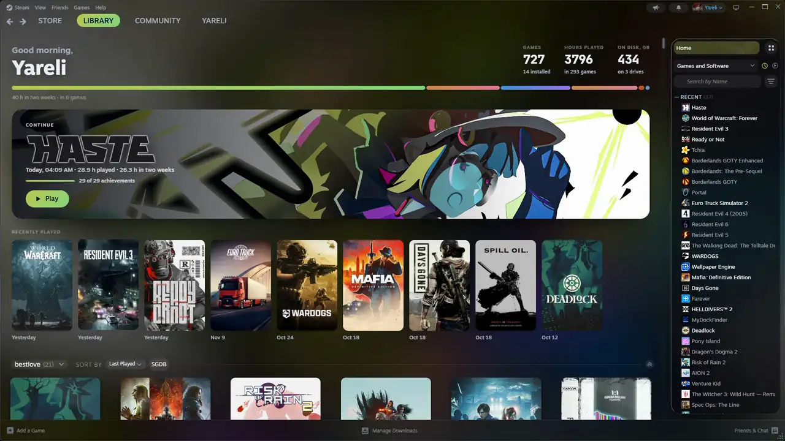
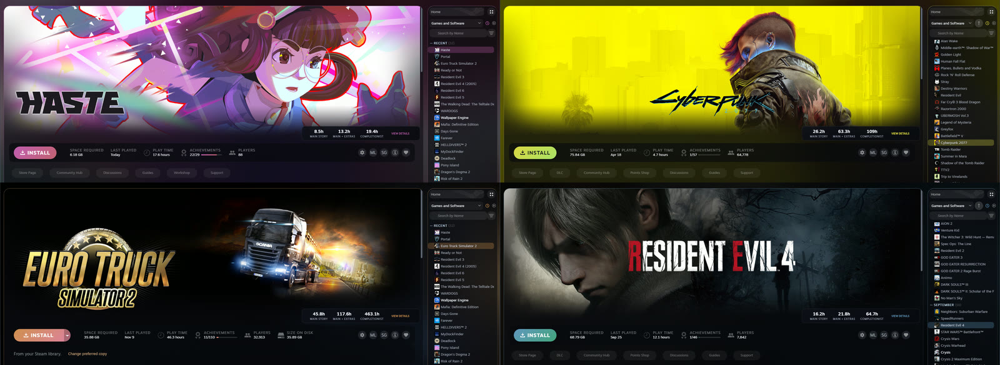
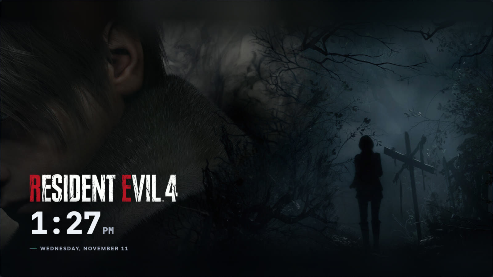
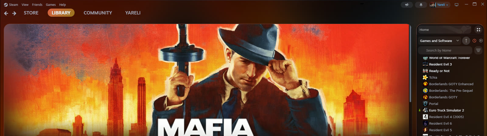
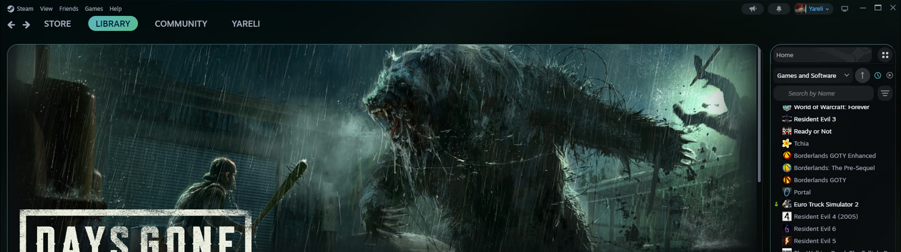
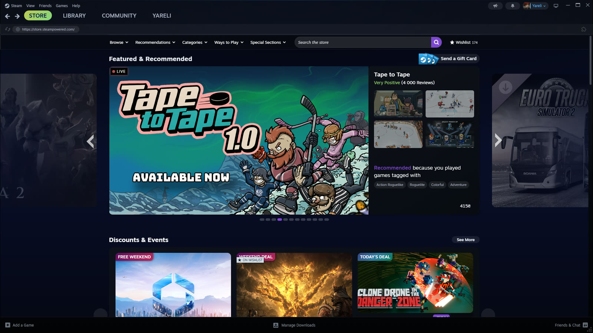
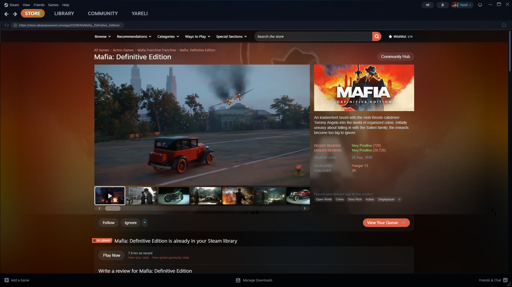
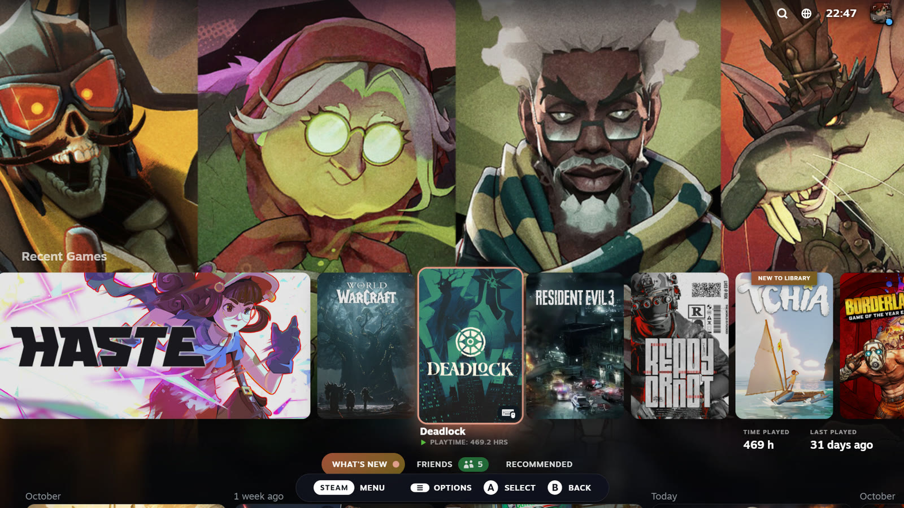

# Glass Dusk

A [Millennium](https://steambrew.app) theme for the Steam desktop client. Smoked glass panels sit over the art of the game you have open, and the client takes its accent colour from that art. Open another game and the whole client changes colour with it.



## What it styles

- **Library.** Two panes of smoked glass over the blurred art of the open game, with the game list on the right. The glass has a fine grain, and its edges catch the game's colour. The home page gets its own header: greeting, library stats of your choosing, *Continue* for the last game, recent games.
- **Colour.** Every game lends the client two colours out of its art, close on the wheel and equally bright. Buttons and bars run from one to the other, and when you open another game the colour flows to the new one. Every game keeps its colours: the row under the pointer in the game list wears its own game's, and the home shows your last two weeks as one bar in the colours of what you played.
- **The still.** Left alone on the library, Steam becomes the art of the game in view, with its logo, the time and the date. Move the pointer and the client is back.
- **Game page.** The hero art runs edge to edge, the play bar is one flat card, and page links become chips.
- **Store.** All of it, on the same dark glass with the same buttons, chips and cards: the front page, a game's page in its art and colour, search, every hub (Specials, each category, tag and genre, Demos, VR…), the store menu, the wishlist, the cart, the charts, the personal calendar, the recommender, your account's pages, the Points Shop and the News Hub. The price and *Add to Cart* blocks, the landing pages and the art of sale events stay as Steam draws them.
- **Menus, settings and notifications.** All wear the same colour as the main window.
- **Friends and chat.** Status keeps Steam's colours and becomes a ring round each avatar; friends in a game glow green; groups, conversations, channels and the field you type in are glass and accent.
- **Sign-in.** The account chooser (*Who's playing?*) and the signing-in screen after it sit on the art of the game you played last, on the covers of your own games drifting past, or on a slideshow of your games' art, with the chooser on a card of glass. Steam shows them only when it is set to ask which account to use.
- **Plugins.** Millennium plugins with an interface of their own take the theme's colours: HLTB for Steam, Achievement Groups, Player Count, Extendium. Size on Disk, Non-Steam Playtimes and Easy SteamGrid match as they are. Browser extensions added through Extendium (SteamDB, Augmented Steam) put their blocks on store pages in the same cards as Steam's own.
- **Community and profiles** stay as Steam draws them. Profiles carry their owners' own backgrounds and themes, and a half-restyled community reads worse than an untouched one.
- **Big Picture.** The focused game's art fills the home, sharp, with the carousel at its foot, and lends its two colours to tabs, buttons and the ring round whatever the controller is on. Under the carousel stand the game's numbers: time played, last played, achievements. The art lies further back under every other screen; a game's page, the library, the settings, the Steam menu and the Quick Access menu are smoked glass over it.
- **In-game overlay (Shift+Tab).** A light veil replaces Steam's near-black sheet, so the game stays visible. *Game Overview* and the toolbar become smoked glass in the running game's colour.










## Settings

Millennium → Themes → Glass Dusk → ⋯ → Settings. Changes apply after Steam restarts.

| Setting | Values | What it does |
|---|---|---|
| Wallet balance | **Show** · Blur until hover | The balance in the top bar. Blurred, it shows when you point at it. |
| Theme language | **English** · Українська · Français | Text the theme draws itself: home header, Big Picture chip, dates. Steam's own text follows Steam. |
| Background | **Game art** · Meadow · Plain dusk | What sits behind the glass. |
| Background art | **Normal** · Subtle · Vivid | How strongly the game art shows through. |
| Accent colour | **Game art** · Fixed | *Game art*: the colours of the game in view, and with none in view (store, community, downloads) the last one's. *Fixed* keeps the Accent colour from the Colors tab everywhere. |
| Accent style | **Two-tone** · Solid | *Two-tone* takes a second colour from the game art, close to the first and as bright, and runs the main buttons and the progress bars from one to the other. *Solid* is one colour. |
| Glass | **Normal** · Denser · Sheerer | How see-through the panels are. |
| Glass finish | **Grain and lit edge** · Grain · Lit edge · Plain | The surface of the glass panels: a fine grain, and the edges that face the light lit in the accent. *Plain* is smooth glass with an even hairline. |
| Corners | **Normal** · Softer · Sharper | Radius of panels and cards. |
| Transitions | **Flowing** · Instant | Opening another game: the accent flows from the old colour to the new one and the art behind the glass fades over, or both change at once. The system's "reduce motion" setting also makes them instant. |
| Sign-in screen | **Game art** · Your games · Slideshow · Dusk · Steam's wall · Steam | The account chooser when Steam starts (*Who's playing?*) and the signing-in screen after it: the art of the game you played last, the covers of your own games drifting past, the art of your games one after another, plain dusk or Steam's wall of covers, each with the theme's glass and colour; or Steam's own look. It only shows if Steam asks which account to use. |
| When idle | **After 5 minutes** · After 2 minutes · After 15 minutes · Never | Left alone on the library, Steam becomes the art of the game in view, with its logo, the time and the date; the first move brings everything back. Not while something is downloading or a video is playing, and not over the store. |
| Library home | **Theme** · Steam | The theme's home header, or Steam's shelves only. |
| Home number: Games, Hours played, On disk | **on** · off | Three numbers in the home header, a switch for each. |
| Home number: Hours, 2 weeks, Unplayed, Perfect games | on · **off** | Three more, a switch for each. *Perfect games* are the ones with every achievement unlocked. |
| Home numbers: second line | on · **off** | A small line under each number: games installed, games played, share of the library, average completion, drives. |
| Home: two weeks in colour | **on** · off | A bar under the greeting: every game played in the last two weeks, as wide as its share of the hours and in its own colours. Point at a part to see the game and its hours; a click opens it. |
| Recently played shelf | **on** · off | The row of recently played games under the *Continue* card. |
| Recently played: preview | **on** · off | Point at a cover in that row: a card with the game's screenshots, its name and hours. The store's screenshots are fetched from Steam at that moment. |
| Home games | **Installed** · Whole library | Where *Continue* and the recently played row take their games: what is installed here, or the whole library. A game that is not installed gets *Install* instead of *Play*. |
| Continue card: achievements | on · **off** | Achievement progress of the game on the *Continue* card. |
| What's New shelf | on · **off** | Steam's What's New shelf on the home page. |
| Add shelf button | **on** · off | Steam's *Add shelf* row on the home page. |
| Game list side | **Right** · Left | Where the game list sits. |
| Store: game list | **Off** · Pinned · On hover · Rail | Your game list beside the store and other web pages of the client: pinned there, coming out when you point at the window's edge, or a rail of your last games' covers with a button that opens the list. It is Steam's own list, with its collections, search and filters. |
| Game page: collection tags | **on** · off | The collections a game is in, at the top right of its art, as Steam shows them. A click opens the collection. |
| Big Picture | **Cover** · Steam | Whole-screen art of the focused game, or Big Picture untouched. |
| Big Picture home | **Big art** · Steam's | *Big art*: the art sharp across the first screen and the carousel at its foot, as in Steam's Big Art Mode, whether or not that setting of Steam's is on. *Steam's* leaves the layout to that setting. |
| Big Picture hours chip | **on** · off | The focused game's numbers under the carousel: time played, last played, achievements. |
| Overlay background | **Transparent** · Steam | Behind the Shift+Tab panels. |
| Overlay panels | **Glass** · Steam | *Game Overview*, the browser and the toolbar. |
| Plugins | **Theme** · Plugin's own | Plugins with their own interface: in the theme's colours, or as they ship. |

The **Colors** tab has six colours: accent, text, secondary text, glass tint, play bar, store background.

## Install

- **From steambrew.app:** open [Glass Dusk in the theme catalogue](https://steambrew.app/theme/0hs3xMU5Eb85uvIALzkq), press *Copy Theme ID* and paste it into Millennium → Themes → Install.
- **By hand:** download this repository and put the folder into `Steam/millennium/themes/`, then pick it in Millennium → Themes.

Tested on Windows 11 with Steam client 1788652215 and Millennium 3.5.0, and on Ubuntu 24.04 with the fix below.

### Linux

If the game list has moved to the right but the top bar, the library and game pages still look like stock Steam, Millennium's web helper hook did not load. The theme is written against Steam's readable class names. Millennium (3.4.0 and newer) is what puts them back, and on Linux its installer links the hook from `/usr/lib/millennium`, which Steam's web helper cannot see from inside its container. Until that is fixed in Millennium, close Steam and replace the two links with copies:

```bash
cd ~/.steam/steam/ubuntu12_64
rm -f libXtst.so.6 libmillennium_hhx64.so
cp /usr/lib/millennium/libmillennium_bootstrap_hhx64.so libXtst.so.6
cp /usr/lib/millennium/libmillennium_hhx64.so libmillennium_hhx64.so
```

Start Steam again, and repeat this after every Millennium update. It is for a regular Steam install with Millennium from its install script or the AUR (`ubuntu12_64` is Steam's own folder name on every distribution). NixOS keeps these files elsewhere, and Millennium does not support Steam from Flatpak or Snap.

## Good to know

- The overlay cannot blur the game behind its panels. Steam composites the game outside the page, so the glass there is a denser tint instead.
- Very large custom artwork slows Big Picture down, with or without this theme. Animated PNG covers from SteamGridDB can run to tens of megabytes. If Big Picture stutters when a cover scrolls into view, a lighter version of that cover helps.
- The numbers under the Big Picture carousel are information only: a controller can't select them.
- *Perfect games* counts games with every achievement unlocked. Steam has no idea whether you finished a game's story, so this is the closest it gets to "completed". While that number is on, the theme keeps Steam's achievement data fresh: Steam is asked about a game you played since it last looked, and about every played game once a day.
- Steam's Big Picture has a screensaver of its own (Settings → Customization). A Glass Dusk one, the theme's dusk with the time and the date, is in [extras/screensaver](extras/screensaver/README.md). It is optional, experimental and installed by hand: the theme never writes into your Steam folder, and the page has not been tried inside Steam.
- The Steam menu and the Quick Access menu of Big Picture are styled from the Big Picture window, because Millennium does not load themes into them. If a Steam update moves them, they go back to Steam's own look until the theme catches up; nothing else is affected.

## Support

The theme is free and stays free. If you like it, you can leave a tip on [Ko-fi](https://ko-fi.com/yareli0i). Bugs and ideas go to [Issues](https://github.com/Yareli0i/glass-dusk/issues).

## Credits

- Code: [MIT](LICENSE).
- Number font: JetBrains Mono ExtraBold, [SIL OFL 1.1](assets/OFL-JetBrainsMono.txt).
- Meadow background: by the author.
- French translation: [Warzox](https://github.com/ImWarzox).
- Game art is shown straight from your Steam library and belongs to its owners.

Changes: [CHANGELOG.md](CHANGELOG.md). How the theme is put together: [DEVELOPMENT.md](DEVELOPMENT.md).

---

## Українською

Тема для Steam на Millennium: димчасте скло поверх арту відкритої гри, а колір кнопок і виділень береться з цього арту. Стилізує бібліотеку, сторінку гри, крамницю, меню, Big Picture й оверлей у грі. Спільноту й профілі лишає такими, як їх малює Steam.

Текст, який малює сама тема, за замовчуванням англійський. Українську вмикає налаштування **Theme language → Українська**. Решту налаштувань описано в таблиці вище, змінюються вони в Millennium → Themes → Glass Dusk → Settings і діють після перезапуску Steam.

На Linux тема може застосуватися лише частково: список ігор переїхав праворуч, а шапка, бібліотека й сторінка гри лишилися як у звичайному Steam. Це означає, що не завантажився хук Millennium. Як це виправити, описано вище в розділі [Linux](#linux).
